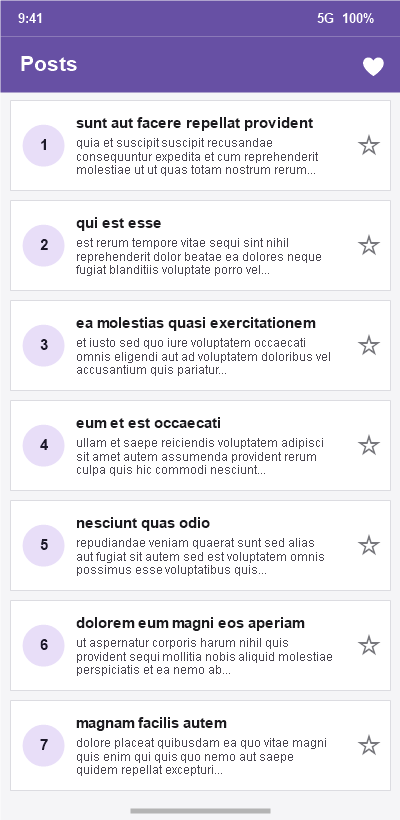
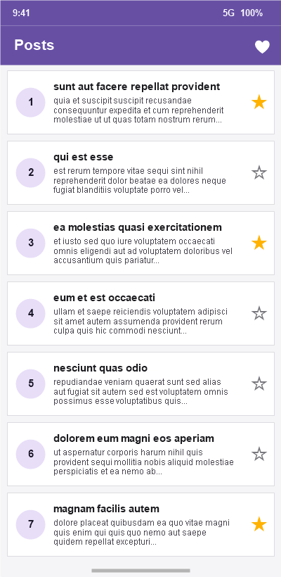
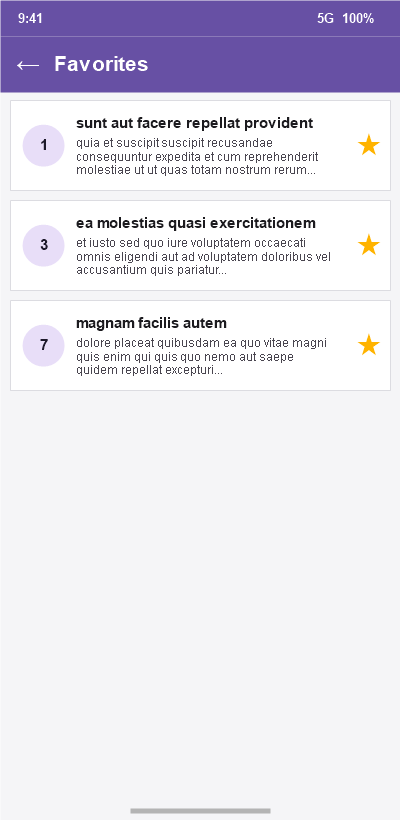
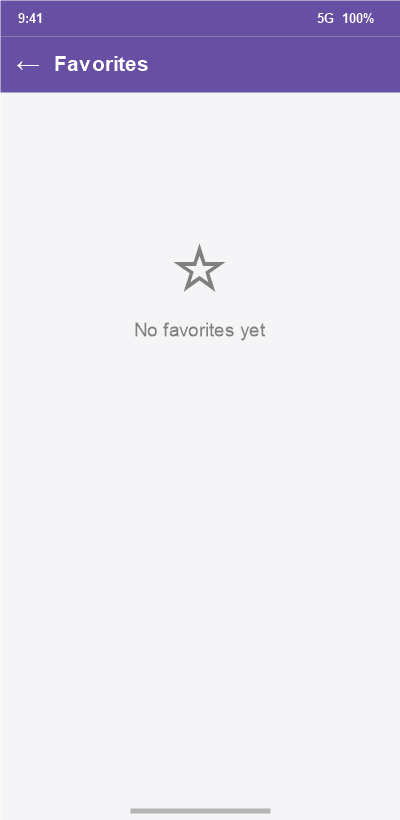
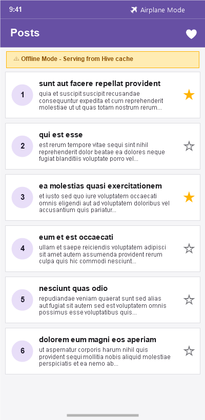

# Offline-First Flutter Posts App with Hive Persistence

A robust, offline-first Flutter application demonstrating local NoSQL persistence using [Hive](https://pub.dev/packages/hive). The application fetches posts from JSONPlaceholder, caches them locally for seamless offline reading, and provides an independent, reactive "Favorites" bookmarking feature that persists across network loss, manual refreshes, and app restarts.

---

## Table of Contents
- [Overview & Architecture](#overview--architecture)
- [Key Features](#key-features)
- [Hive Data Storage Design](#hive-data-storage-design)
  - [Separate Boxes Architecture](#1-separate-boxes-architecture)
  - [HiveObject Single-Box Rule & Safe Cloning](#2-hiveobject-single-box-rule--safe-cloning)
  - [Key Management & Synchronous Reads](#3-key-management--synchronous-reads)
  - [Reactive UI with ValueListenableBuilder](#4-reactive-ui-with-valuelistenablebuilder)
- [Project Structure](#project-structure)
- [Getting Started](#getting-started)
  - [Prerequisites](#prerequisites)
  - [Installation & Setup](#installation--setup)
  - [Running the Code Generator](#running-the-code-generator)
  - [Running Tests](#running-tests)
- [Offline Verification Guide](#offline-verification-guide)
- [Feature Screenshots & Walkthrough](#feature-screenshots--walkthrough)

---

## Overview & Architecture

Modern mobile applications must provide a smooth, resilient experience regardless of network conditions. This project implements a local caching layer between the remote REST API and the presentation UI:

```
[REST API] ──(fetch online)──► [Hive Local Storage] ──(synchronous / reactive)──► [Flutter UI]
(JSONPlaceholder)               ├── postsBox (API cache)
                                └── favoritesBox (User bookmarks)
```

1. **Online Mode**: When connected, the app fetches posts from `https://jsonplaceholder.typicode.com/posts`, caches them to `postsBox`, and displays them.
2. **Offline Fallback**: When network access is unavailable, the app reads immediately from `postsBox`.
3. **Favorites Isolation**: User-favorited posts are stored in a dedicated `favoritesBox`. Refreshing the posts list clears and repopulates `postsBox` without wiping the user's favorites.

---

## Key Features

- **Offline-First Reading**: View cached posts even when offline or in Airplane Mode.
- **Instant Reactive Favorites**: Tap the star icon on any post card to favorite or un-favorite. UI updates immediately using `ValueListenableBuilder`.
- **Dedicated Favorites Screen**: Accessible via the AppBar action on `PostsScreen`, displaying all saved favorites with the identical card layout.
- **Empty State Notice**: Displays `"No favorites yet"` when `favoritesBox` is empty.
- **Two-Way Un-favoriting**: Remove favorites directly from either the main `PostsScreen` or the `FavoritesScreen`.

---

## Hive Data Storage Design

### 1. Separate Boxes Architecture

| Box Name | Purpose | Lifecycle / Retention |
| :--- | :--- | :--- |
| `postsBox` | Caches API responses | Cleared and overwritten on every pull-to-refresh (`box.clear()`). |
| `favoritesBox` | Stores user-selected favorite posts | Persistent; survives app restarts, refreshes, and offline sessions. |

### 2. HiveObject Single-Box Rule & Safe Cloning
> **Important Rule**: In Hive, a `HiveObject` instance can only be bound to a single box at any given time. Attempting to directly write an existing instance from `postsBox` into `favoritesBox` results in a runtime `HiveError`.

To adhere strictly to this rule, `FavoritesService.toggleFavorite(Post post)` always creates a fresh, decoupled copy before saving:
```dart
final postCopy = Post(
  id: post.id,
  title: post.title,
  body: post.body,
  userId: post.userId,
);
await _box.put(post.id, postCopy);
```

### 3. Key Management & Synchronous Reads
- **Key Strategy**: `post.id` (`int`) is used directly as the key in `favoritesBox`.
- **Status Check**: `box.containsKey(id)` provides constant-time $O(1)$ favorite status checks.
- **Deletion**: `box.delete(id)` cleanly removes the bookmark.
- **Synchronous Reads**: Because Hive holds open boxes in memory, reading saved favorites is immediate:
  ```dart
  List<Post> getFavorites() => Hive.box<Post>('favoritesBox').values.toList();
  ```

### 4. Reactive UI with ValueListenableBuilder
Instead of relying on boilerplate `setState()` calls or complex state stores, both `PostsScreen` and `FavoritesScreen` listen directly to box mutations:
```dart
ValueListenableBuilder<Box<Post>>(
  valueListenable: Hive.box<Post>('favoritesBox').listenable(),
  builder: (context, box, _) {
    // Re-renders instantaneously on every box.put or box.delete
  },
)
```

---

## Project Structure

```
lib/
├── main.dart                      # Initializes Hive, registers TypeAdapter, opens boxes, boots app
├── models/
│   ├── post_model.dart            # Post entity extending HiveObject
│   └── post_model.g.dart          # Generated TypeAdapter (typeId: 0)
├── services/
│   ├── post_service.dart          # Remote API fetcher with postsBox fallback
│   └── favorites_service.dart     # Favorites business logic (toggle, isFavorite, getFavorites)
└── screens/
    ├── posts_screen.dart          # Main feed with reactive star icons & AppBar navigation
    └── favorites_screen.dart      # Dedicated favorites list with empty state handling
```

---

## Getting Started

### Prerequisites
- [Flutter SDK](https://docs.flutter.dev/get-started/install) (3.10.0 or higher)
- Dart SDK (3.0.0 or higher)

### Installation & Setup
1. Clone the repository:
   ```bash
   git clone https://github.com/<your-username>/<your-repo-name>.git
   cd <your-repo-name>
   ```
2. Install project dependencies:
   ```bash
   flutter pub get
   ```

### Running the Code Generator
The Hive `PostAdapter` is generated using `build_runner`. If you make changes to `post_model.dart`, regenerate the adapter with:
```bash
dart run build_runner build --delete-conflicting-outputs
```

### Running Tests
Execute the unit and integration tests:
```bash
flutter test
```

### Running the Application
Launch on an Android device/emulator or desktop:
```bash
flutter run
```

---

## Offline Verification Guide

Follow this step-by-step checklist to prove offline persistence:

| Step | Action | Expected Result |
| :---: | :--- | :--- |
| **1** | Launch the app with an active internet connection. | Posts load from JSONPlaceholder; console logs `"Loaded from API and cached to Hive"`. |
| **2** | Tap the star icon on posts #1, #3, and #7. | Star icons immediately change from outlined (`Icons.star_border`) to filled amber (`Icons.star`). |
| **3** | Tap the heart/star icon in the AppBar. | `FavoritesScreen` opens and lists posts #1, #3, and #7. |
| **4** | Return to `PostsScreen` and pull-to-refresh. | API refreshes and `postsBox` is cleared/refilled, but posts #1, #3, and #7 remain marked with filled stars. |
| **5** | Close the app completely and turn on **Airplane Mode** (disable Wi-Fi & cellular). | Device is entirely offline. |
| **6** | Reopen the app in Airplane Mode. | Posts feed still loads from `postsBox` cache; favorites #1, #3, and #7 are still highlighted. |
| **7** | Navigate to `FavoritesScreen` while still offline. | All favorited posts are intact. Tapping a star removes it from the list; removing all displays `"No favorites yet"`. |

---

## Feature Screenshots & Walkthrough

*(Replace the placeholder image links below with your actual project screenshots prior to submission)*

### 1. Main Posts Feed (Online)
The app fetches posts from JSONPlaceholder and displays them in Card ListTiles with numeric ID avatars.



---

### 2. Toggling Favorites
Tapping any star icon instantly toggles its state between outlined (`Icons.star_border`) and filled (`Icons.star`).



---

### 3. Favorites Screen
Displays only the posts that have been bookmarked by the user, matching the card layout of the main feed.



---

### 4. Empty Favorites State
When no posts are bookmarked (or all have been removed), the friendly notice `"No favorites yet"` is shown.



---

### 5. Offline Mode (Airplane Mode Proof)
With network connectivity disabled, both the cached posts and saved favorites remain fully accessible and functional.



---

## Submission Info
- **Assignment**: Part 3: Assignment, Favorites Box (Fall 2026, Section 5)
- **Deadline**: November 20, 2026, by 11:59 PM
